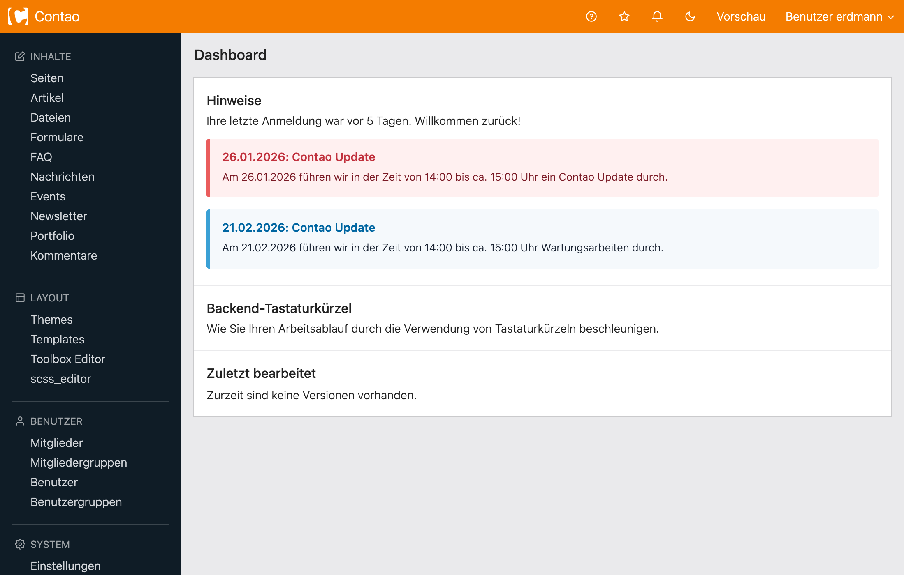

# Contao Status-Updates Bundle

Zeige wichtige Status-Updates wie anstehende Contao Updates im Contao Backend-Dashboard an.

## Funktionen

- **Backend-Modul**: Verwalte Status-Updates über das Menü "Status-Updates" im Backend
- **Datumsbasierte Sichtbarkeit**: Steuere, wann Updates erscheinen (X Tage vor/nach einem Ereignis)
- **Rich-Text-Editor**: TinyMCE-Integration für detaillierte Beschreibungen
- **Dashboard-Widget**: Automatische Anzeige im Backend basierend auf Sichtbarkeitsregeln
- **Flexible Anzeigeregeln**: Konfiguriere, wie lange Updates sichtbar bleiben
- **Farbcodierte Anzeige**: Visuelle Indikatoren für bevorstehende, aktuelle und vergangene Ereignisse
- **Abgeschlossen-Status**: Markiere Updates als erledigt – das Dashboard zeigt sie dann grün mit einem Häkchen-Hintergrund-Icon
- **E-Mail-Benachrichtigung**: Sende beim Abschließen eines Updates automatisch eine Mail an ausgewählte Backend-Benutzer (siehe Abschnitt "Benachrichtigungen")
- **Frontend-Anzeige**: Zeige Status-Updates auch im Frontend an – z.B. Urlaubshinweise mit Zeitraum, Wartungsfenster oder Marketing-Aktionen mit Rabattcode (siehe Abschnitt "Frontend-Anzeige")
- **Feed-Abo**: Übernimm Status-Updates automatisch aus einer zentralen Contao-Installation – z.B. Ankündigungen von Sicherheitsupdates für alle betreuten Websites (siehe Abschnitt "Feed-Abo")

## Installation

Installation über Composer:

```bash
composer require erdmannfreunde/contao-status-update-bundle
```

## Verwendung

### Status-Updates erstellen

1. Navigiere zu **Backend → System → Status-Updates**
2. Klicke auf "Neu", um ein Status-Update zu erstellen
3. Fülle die Felder aus:

- **Titel**: Kurzer beschreibender Titel
- **Beschreibung**: Detaillierte Informationen (unterstützt HTML über TinyMCE)
- **Ereignisdatum**: Das Datum des Ereignisses
- **Benachrichtigung vor Ereignis anzeigen**: Wie viele Tage vor dem Ereignis das Update angezeigt werden soll
  - 7 Tage vorher (Standard)
  - 10 Tage vorher
  - 30 Tage vorher
  - Nur am Ereignistag
- **Benachrichtigung nach Ereignis anzeigen**: Wie viele Tage nach dem Ereignis das Update weiterhin angezeigt werden soll
  - Nur am Ereignistag (Standard)
  - 1 Tag danach
  - 7 Tage danach
  - 30 Tage danach (z.B. für einen vereinbarten Content Freeze)
- **Veröffentlicht**: Aktivieren, um im Dashboard sichtbar zu machen
- **Abgeschlossen**: Markiert das Update als erledigt. Im Dashboard wird es dann grün dargestellt und erhält ein dezentes Häkchen-Icon im Hintergrund. Lässt sich auch direkt aus der Übersicht über das Checkbox-Icon umschalten.

4. Speichere das Status-Update

### Dashboard-Anzeige



Status-Updates erscheinen automatisch im Backend-Dashboard basierend auf den Sichtbarkeitsregeln:

- **Rot/Wichtig**: Ereignisse, die heute stattfinden
- **Gelb/Warnung**: Ereignisse innerhalb der nächsten 3 Tage
- **Blau/Info**: Zukünftige Ereignisse
- **Grün/Erfolg**: Vergangene Ereignisse (innerhalb der "Danach"-Anzeigedauer) sowie als **abgeschlossen** markierte Updates (zusätzlich mit Häkchen-Hintergrund-Icon)

## Sichtbarkeitslogik

Das Bundle berechnet, welche Status-Updates angezeigt werden, basierend auf:

1. **Aktuelles Datum** vs. **Ereignisdatum**
2. **Vorher anzeigen**-Einstellung (wie viele Tage im Voraus)
3. **Danach anzeigen**-Einstellung (wie viele Tage nach dem Ereignis)

Beispiel: Wenn du "7 Tage vorher" und "1 Tag danach" für ein Ereignis am 15. Januar einstellst:

- Das Status-Update wird ab dem 8. Januar angezeigt
- Das Status-Update wird nach dem 16. Januar nicht mehr angezeigt

## Benachrichtigungen

Beim Markieren eines Status-Updates als **abgeschlossen** kann das Bundle automatisch eine E-Mail an ausgewählte Backend-Benutzer versenden.

### Einrichtung

Die Einstellungen sind über das Zahnrad-Icon oben rechts in der Status-Updates-Übersicht erreichbar (keine eigener Sidebar-Menüpunkt).

Verfügbare Felder:

- **E-Mail-Benachrichtigung aktivieren**: Master-Schalter. Wenn aus, wird nichts versendet.
- **Betreff**: Betreff der Mail. Unterstützt die Platzhalter `##title##`, `##date##`, `##description##`.
- **Nachricht**: HTML-Body der Mail (TinyMCE). Unterstützt dieselben Platzhalter sowie Contao-Insert-Tags.
- **Empfänger**: Mehrfach-Auswahl aller Backend-Benutzer. Der aktuell angemeldete Benutzer wird **immer automatisch** ergänzt – auch wenn niemand sonst angehakt ist.

### Verhalten

- Der Versand läuft pro Status-Update **genau einmal** (Flag `notification_sent`). Auch wenn der Status zwischendurch wieder geöffnet und erneut abgeschlossen wird, geht keine zweite Mail raus.
- Der Versand erfolgt über die in Contao konfigurierte Standard-Versandart (Symfony `MailerInterface`, gesteuert über `MAILER_DSN`).
- Als Absenderadresse wird die unter „System → Einstellungen → Administrator-E-Mail-Adresse" hinterlegte Adresse verwendet.
- Backend-Benutzer ohne hinterlegte E-Mail-Adresse oder mit ungültiger Adresse werden übersprungen.
- Insert-Tags in den Settings (z.B. `{{date}}`) werden ausgewertet; Insert-Tags in nutzergenerierten Status-Update-Feldern (Titel/Beschreibung) werden bewusst **nicht** ausgewertet, um eine Insert-Tag-Injection durch Editoren mit eingeschränkten Rechten zu verhindern.

## Frontend-Anzeige

Status-Updates können auch im Frontend ausgegeben werden – z.B. für:

- Urlaubs- oder Abwesenheitshinweise mit konkretem Zeitraum
- Wartungsfenster oder Störungsinfos
- Marketing-Aktionen wie zeitlich begrenzte Rabattcodes

### Einrichtung

1. Beim Status-Update das Feld **Anzeigebereich** auf "Nur im Frontend" oder "Backend und Frontend" stellen
2. Optional: **Anzeigen bis** setzen – das Update läuft automatisch aus, sobald dieses Datum überschritten ist. Leer lassen für ein dauerhaftes Update
3. **Typ** wählen (Neutral, Info, Erfolg, Warnung, Kritisch, Aktion) – steuert die Standard-Farben
4. Optional: **Kann geschlossen werden** aktivieren, damit Besucher:innen den Hinweis schließen können (Auswahl wird per `localStorage` gemerkt, bis das Update erneut bearbeitet wird)
5. Optional: **Auf Seiten einschränken** – leer lassen, um den Hinweis auf allen Seiten anzuzeigen. Bei Auswahl einer Seite wird das Update auf dieser Seite **und allen Unterseiten** angezeigt
6. Im Seitenlayout das **Frontend-Modul „Status-Updates"** platzieren (z.B. im Header oder als Banner-Slot)

### Auswahllogik

Im Frontend wird ein Update angezeigt, wenn:

- veröffentlicht und nicht als abgeschlossen markiert
- Scope ist "Frontend" oder "Backend und Frontend"
- Heute liegt im Zeitraum **Datum** – **Anzeigen bis** (jeweils inkl.) bzw. ab **Datum**, falls kein Anzeigen-bis gesetzt ist
- Aktuelle Seite (oder eine ihrer Elternseiten) gehört zur Auswahl – oder die Auswahl ist leer

Mehrere aktive Updates werden nach Typ-Priorität sortiert: Kritisch > Warnung > Info > Erfolg > Aktion > Neutral.

### Styling

Die Default-Styles liegen in `public/css/frontend_status_updates.css`. CSS und Dismiss-JS werden **nur dann geladen, wenn das Modul auf der Seite tatsächlich aktive Updates rendert** – verwaltet über `` / `` im Twig-Template (`add 'key' to stylesheets/body`-Pattern wie beim Contao-Swiper). Das JS lädt zusätzlich nur, wenn mindestens ein Update als „schließbar" markiert ist.

Override im Theme-SCSS in einer separaten Override-Datei (LASR/SOLO-Konvention) – nicht direkt im Theme-SCSS.

Die Twig-Templates lassen sich überschreiben:

- `frontend_module/status_updates.html.twig` (Modul-Wrapper inkl. Asset-Blöcke)

Das Template stellt benannte Override-Blöcke bereit, sodass ein Theme nur den relevanten Teil austauschen muss, ohne das gesamte Template zu kopieren:

| Block | Zweck |
| --- | --- |
| `status_updates_styles` | Stylesheet-Einbindung — Bundle-CSS unterdrücken oder eigenes laden |
| `status_updates_scripts` | Script-Einbindung — Dismiss-JS ersetzen oder weglassen |
| `status_updates_noscript` | `<noscript>`-Fallback für dismissible Items |
| `status_updates_items` | Wrapper-Div + Items-Schleife — komplettes Markup ersetzen |
| `status_updates_item` | Markup eines einzelnen `<article>` |
| `status_updates_close` | Schließen-Button |

Beispiel: Bundle-CSS unterdrücken und eigenes Stylesheet aus dem Theme laden:

```twig



    
        <link rel="stylesheet" href="{{ asset('files/theme/css/status-updates.css') }}">
    

```

## Feed-Abo

Das Bundle kann einen Status-Update-Feed abonnieren, den eine andere Contao-Installation mit dem kostenpflichtigen [contao-status-update-feed-bundle](https://github.com/erdmannfreunde/contao-status-update-feed-bundle) bereitstellt. Das Abonnieren selbst ist kostenlos und benötigt keine Lizenz. So lassen sich Ankündigungen – etwa zu kritischen Sicherheitsupdates – einmal zentral pflegen und erscheinen automatisch im Backend-Dashboard aller abonnierenden Installationen.

### Einrichtung

Die Feed-URL wird in der `config/config.yaml` des Projekts hinterlegt und mit dem Projekt deployt:

```yaml
erdmannfreunde_contao_status_update:
    feed_url: 'https://www.example.com/status-updates.json'
```

- Ohne `feed_url` ist das Abo aus.
- Erlaubt sind nur `https://`-URLs, sonst bricht der Container-Build mit einer Fehlermeldung ab.
- Nach dem Eintragen: Cache leeren und `contao:migrate` ausführen.

### Verhalten

- Ein Contao-Cronjob holt den Feed **stündlich** ab. Empfohlen ist ein System-Cron (`contao:cron` minütlich); ohne ihn greift der Web-Cron über Frontend-Aufrufe.
- Manuell synchronisieren: `vendor/bin/contao-console contao:cron --force "ErdmannFreunde\ContaoStatusUpdateBundle\Cron\FeedSyncCron"`
- Importierte Updates landen als normale Status-Updates in der Übersicht, gekennzeichnet mit `[Feed]` hinter dem Datum. Sie erscheinen **nur im Backend**, nie im Frontend.
- Titel, Beschreibung, Datum und Vorlauf/Nachlauf kommen aus dem Feed und werden bei Änderungen überschrieben. Die Bearbeiten-Maske zeigt deshalb nur **Veröffentlicht** und **Abgeschlossen** – diese beiden Felder sind lokal und bleiben bei jeder Synchronisierung erhalten.
- Markiert der Sender ein Update als **abgeschlossen**, wird es auch hier abgeschlossen und die Abschluss-Mail verschickt (siehe "Benachrichtigungen") – genau einmal, wie beim Abschließen im Backend. Empfänger sind nur die in den Einstellungen ausgewählten Backend-Benutzer, da beim Abruf niemand angemeldet ist. Ein lokal gesetztes "Abgeschlossen" nimmt der Feed nie zurück.
- Kommt ein Update bereits abgeschlossen an, wird es ohne Mail angelegt – es war hier nie als offen sichtbar.
- Läuft der Abruf über den CLI-Cron, stellt Contao die Abschluss-Mail in die Messenger-Warteschlange. Versendet wird sie vom Messenger-Worker bzw. beim nächsten Seitenaufruf.
- Wird ein Update aus dem Feed entfernt (zurückgezogen oder 30 Tage nach dem Ereignis), verschwindet es auch hier.
- Ausblenden statt löschen: Ein lokal gelöschtes Feed-Update wird beim nächsten Abruf neu angelegt, ein ausgeblendetes bleibt ausgeblendet.
- Ist der Feed nicht erreichbar oder ungültig, bleibt alles unverändert; der Grund steht im System-Log.

### Sicherheit

Der Feed-Inhalt wird wie fremder Inhalt behandelt:

- Abruf nur per HTTPS, ohne Weiterleitungen, mit Timeout und Größenlimit (512 KB, max. 50 Einträge)
- Die Beschreibung läuft durch eine HTML-Allowlist (`p`, `br`, `strong`, `b`, `em`, `i`, `ul`, `ol`, `li`, `a`); Links nur `https`/`mailto`, Bilder, Skripte und Event-Handler werden entfernt
- Insert-Tags im Feed werden nicht ausgeführt
- Die Feed-URL lässt sich nur über die Projekt-Konfiguration ändern, nicht im Backend

## Anforderungen

- PHP 8.2 oder höher
- Contao 5.3 oder höher
- Symfony 6.4 oder 7.0

## Lizenz

Dieses Bundle ist unter LGPL-3.0-or-later lizenziert.
